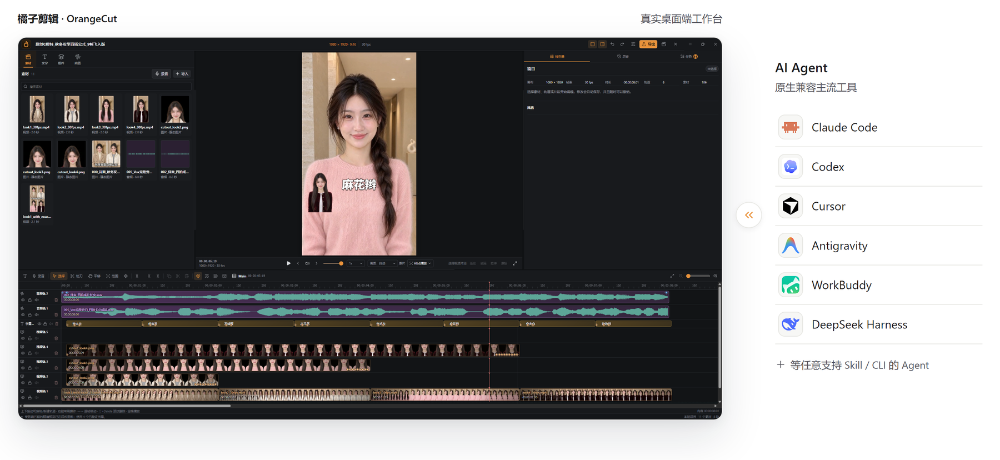
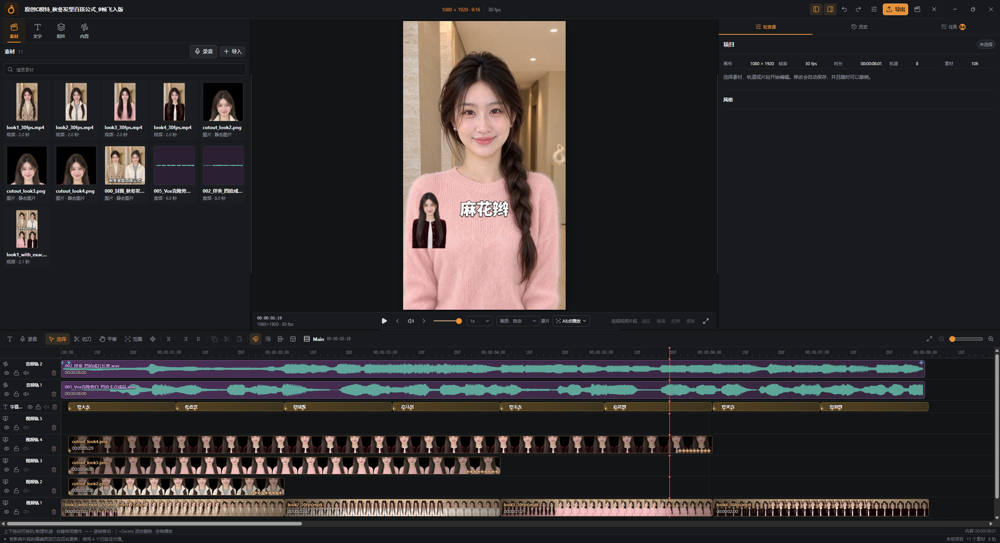

# OrangeCut

**Agent-Native Video Editor · Let AI edit. Preview and refine at any time.**

[中文](./README.md) | **English**

[Download](https://orangecut.timor419.com/desktop) · [Installation SOP](./INSTALL.md) · [Unified Skill](./skills/orangecut/SKILL.md) · [Help Center](https://orangecut.timor419.com/help)

## Why Agent-Native Video Editing?

OrangeCut is an **Agent-Native Video Editor** for short-form video production. Your AI Agent understands footage, plans the story, and calls a local CLI. OrangeCut preserves a genuinely editable project with a non-destructive multitrack timeline, live desktop preview, and deterministic export.

| Approach | Useful for | Revision and delivery boundary |
| --- | --- | --- |
| Black-box AI video generation | Creating new shots from prompts | Output is usually a flattened video; precise cuts, captions, and mixing are difficult to revise individually |
| FFmpeg-only scripts | Encoding, filters, and batch processing | No directly reviewable desktop editing timeline; revisions often require changing scripts |
| OrangeCut + an AI Agent | Footage assembly, captions, precise cuts, and iterative review | AI edits directly; people can preview, refine, or undo while preserving the editable structure |

OrangeCut does not embed a chat assistant or replace upstream video generation, voice synthesis, or model services. Choose your own Agent and generation tools; OrangeCut supplies the reviewable, revisable editing environment.

## Quick Start — Copy One Prompt to Your AI Assistant

“One minute” means submitting the installation request, not a promise about download or installation duration. Copy this entire prompt to an AI assistant with local command execution:

~~~text
Fetch the complete trusted distribution mirror from https://github.com/puke3615/OrangeCut-Skill and read INSTALL.md, manifest.json, and agent-update.json. Confirm my current Agent's Skill directory, then follow the SOP to install OrangeCut v0.1.0 and the unified orangecut Skill/oc CLI in my Windows x64 user directory. Verify the size and SHA256 of the desktop ZIP and all Agent components, refresh PATH, and run oc --version and oc license status --json. Stop on any failure; never skip verification, request administrator privileges, overwrite unmanaged Skills, or delete existing projects.
~~~

Alternatively, get the runtime package from the [official desktop download page](https://orangecut.timor419.com/desktop), then follow [INSTALL.md](./INSTALL.md) for verification and CLI/Skill registration. Do not download just the README or run installation scripts from unknown sources.

Check the installation:

~~~powershell
oc --version
oc license status --json
~~~

The first command checks the CLI version. The second queries the Community/Pro tier decided by the desktop service; it does not purchase or activate anything. Use `oc --no-autostart license status --json` to query only an already running service. Installation success is not license activation, desktop launch verification, footage preview, or human creative acceptance.

## Supported AI Agents

Compatible with **Claude Code, OpenAI Codex, Cursor, Antigravity, WorkBuddy, DeepSeek Harness**, and any Agent that can read Skills and execute a local CLI. Compatibility means using the same `orangecut` Skill and `oc` command contract, not a universal installer or independent certification of every tool version.

| Agent | Skill directory and registration |
| --- | --- |
| OpenAI Codex | Typically `~/.codex/skills/orangecut/`; the SOP defaults to `~/.codex` as the Agent home |
| Claude Code | Typically `~/.claude/skills/orangecut/`; set the SOP Agent home to your own `~/.claude` directory |
| Cursor | Register through the current version's user/project Skill settings; use its supported `skills/orangecut/` directory rather than a Codex home |
| Antigravity | Register `skills/orangecut/` in the Agent's Skill configuration after confirming its actual directory and discovery mechanism |
| WorkBuddy | Use the Agent's Skill import or directory configuration for the same Skill and confirm local CLI execution permission |
| DeepSeek Harness | Point the chosen Harness's Skill loader at the same directory and confirm it can invoke local `oc` |

Agent homes, project scope, and reload procedures differ. Confirm the directory from the user's or Agent's configuration. If uncertain, stop registration rather than guessing paths or uninstalling another Agent's Skill. Reload the Skill after installation and run `oc --version` to verify command discovery.

## Features & Highlights

### Agent-Native CLI and One Tier-Aware Skill

`oc` exposes local semantic video editing commands. The `orangecut` Skill teaches Agents how to use them. One base Skill detects Community/Pro capabilities; activating Pro does not require reinstalling it. Agents check the tier before advanced plugins, hardware encoding, or higher-resolution exports. Community defaults to free capabilities instead of repeatedly retrying gated operations.

### Live Desktop Preview and Human-in-the-Loop Review

The Agent and desktop share the **same Live Session**, rather than editing a separate invisible copy. An Agent can submit a **ProposedChangeSet** for review; only accepted changes become applied edits. Linear undo/redo remains available. Preview the cuts, text, and sound on the desktop, adjust them yourself, or ask AI for another revision. These screenshots show the real workspace, not a concept mockup.

### Bundled Offline Chinese ASR and Open-Source Fonts

The runtime includes **Paraformer Chinese automatic speech recognition (ASR)** and an open-source font library for local transcription and caption production, without an extra cloud speech recognition API. Initial Python/uv setup and optional plugin installation may still require networking. Offline ASR does not mean every installation step or AI service runs offline.

### Non-Destructive Semantic Timeline

Multitrack video and audio, subtitles, styled text, stickers, transitions, keyframes, and audio mixing remain editable in the project instead of being flattened into a single deliverable. Refine timing, position, styling, and pacing later. Persistent changes pass through validated semantic commands and recorded events. Unsupported capabilities fail explicitly instead of silently reducing quality.

### Extensible Skills for Vertical Creative Workflows

Build book recommendation videos, culture and food stories, talking-head edits, or film commentary workflows on top of the same base `orangecut` Skill. Scenario Skills handle creative rules and footage decisions; the base Skill supplies consistent editing actions. This is an extension architecture, not a promise of built-in one-click generation for every scenario. Users remain responsible for media rights and upstream services.

### Local-First, Low-Impact Portable Installation

The Windows x64 runtime installs in the current user's directory without administrator privileges. Community does not require an account. The SOP verifies size and SHA256 for both the desktop ZIP and Agent resources, then calls the official registrar with explicit user PATH and desktop-shortcut registration. It does not modify system PATH or erase project/license data. Hash verification checks bytes; it is not publisher code signing.

## Architecture / Workflow

~~~mermaid
flowchart LR
    A[Source footage and creative brief] --> B[AI Agent reads orangecut Skill and calls oc CLI]
    B --> C[OrangeCut desktop preview and human refinement]
    C --> D[Deterministic watermark-free export]
~~~

The Agent understands and arranges; OrangeCut owns project truth, review, and execution. Export after reviewing the result. Deterministic execution is not automatic creative acceptance.

## Free Community Edition and Pro

A DaVinci-style freemium model keeps core editing free while reserving advanced local processing and export capabilities for Pro. OrangeCut is not affiliated with DaVinci.

| Capability | Free Community | Pro Membership |
| --- | --- | --- |
| Full project read/write and AI/CLI editing | Included | Included |
| Live desktop preview, reviewable proposals, undo/redo | Included | Included |
| Offline Chinese ASR (Paraformer) and open-source fonts | Bundled free | Also included |
| Landscape/portrait watermark-free CPU export | <= 1080p | Included |
| 19 advanced local AI OCP plugins | Requires Pro | Install on demand; individual dependencies apply |
| NVENC GPU hardware encoding | Not included | Requires compatible NVIDIA hardware and drivers |
| > 1080p exports, such as 4K | Not included | Subject to footage, resources, and hardware constraints |
| Licensing & Pricing | Free forever, no activation key required | Current plans, pricing, and activation are maintained on the [official pricing page](https://orangecut.timor419.com/pricing) |
| Free cloud compute, upstream model APIs, or Agent credits | Not included; bring your own | Not included; bring your own |

The Community size limit is precisely long edge <= 1920 and short edge <= 1080, covering both landscape and portrait. It does not permit unlimited dimensions at arbitrary aspect ratios.

The desktop client and Skill only check Community vs. Pro status without hardcoding prices or contact handles; current plans, offers, upgrades, and support contact live on the [official pricing page](https://orangecut.timor419.com/pricing) ([Contact Support](https://orangecut.timor419.com/pricing#contact)). A verified license can work offline for up to 14 days, subject to its actual deadline; losing Pro never deletes your projects. Activate in desktop Settings → License Management.

## Repository Layout & Integrity

~~~text
OrangeCut-Skill/
├── README.md                 Chinese documentation
├── README.en.md              English documentation
├── INSTALL.md                Windows x64 installation SOP
├── manifest.json             Desktop ZIP URL, size, and SHA256
├── agent-update.json         Agent inventory bound to desktop hash
├── skills/orangecut/         Public mirror of the unified Skill
├── agent-install/            Official installers, CLI wheel, and Skill payload
├── assets/                   Website and desktop screenshots
└── .gitattributes            Disable Agent resource newline conversion
~~~

This is an **allowlisted, privacy-scanned, one-way distribution mirror**. It contains neither the desktop application's source code nor private Git history and is not a reverse development source. It distributes only the official CLI/Skill installation resources and documentation, without building desktop source.

`agent-update.json` binds each component's size/SHA256 to the published desktop ZIP. Skill/CLI updates do not require rebuilding that large ZIP: the SOP verifies and refreshes components while retaining old resource backups, without claiming the old ZIP already contains them. The generated `.gitattributes` fixes `agent-install/** -text` so Windows Git newline conversion cannot alter component hashes. Path traversal, symlinks/reparse points, and unknown files are rejected. Stop if integrity or source trust cannot be established.

## FAQ

**What system is required? Is macOS available?** The current portable package targets Windows x64 and uses ordinary PowerShell 5.1+. This is not an ARM64 installation path. Allow space for the ZIP, extracted files, and upgrade backups. No macOS portable package acceptance is currently provided; this Windows SOP does not apply to macOS and makes no Mac delivery claim.

**What if Python or uv is missing?** The SOP probes existing runtimes, excludes WindowsApps Python placeholders, and obtains missing dependencies from pinned official sources. Administrator privileges are not needed, but first-time setup may require networking. Stop on dependency verification failure.

**How do proxies and direct downloads work?** Official direct download hosts (`orangecut-dl.auroraflow.co`) and `orangecut.timor419.com` use direct downloads by default. Fallback mirrors such as GitHub Releases explicitly use `HTTPS_PROXY` when configured. Set `ORANGECUT_PROXY_ALL=1` to apply that proxy to every SOP download. uv-managed Python downloads follow uv's own proxy behavior.

**What if SmartScreen or corporate policy blocks execution?** Verify the official source, size, and hash first, then inspect file properties and security warnings. SHA256 is not code signing and does not guarantee a warning-free launch. Do not disable security software, bypass corporate policy, or request elevation. Stop and contact the Help Center if safety cannot be established.

**Are video generation, TTS, and Agent subscriptions free too?** No. Neither Community nor Pro includes upstream AI generation services, cloud compute, Agent credits, or model API credits. Select, configure, and pay for those independently. OrangeCut does not embed chat or provider orchestration.

**Will upgrading erase projects or force payment?** No. The SOP retains projects and license credentials, preserves old resources, and does not merge obsolete installation components. If Pro becomes unavailable, Community project access and basic export remain usable. Do not delete user directories to resolve installation conflicts.

## Official Links

- [Website](https://orangecut.timor419.com)
- [Windows Desktop Download](https://orangecut.timor419.com/desktop)
- [Pricing & Pro](https://orangecut.timor419.com/pricing)
- [Contact Support](https://orangecut.timor419.com/pricing#contact)
- [Help Center](https://orangecut.timor419.com/help)
- [OrangeCut-Skill Public Repository](https://github.com/puke3615/OrangeCut-Skill)
