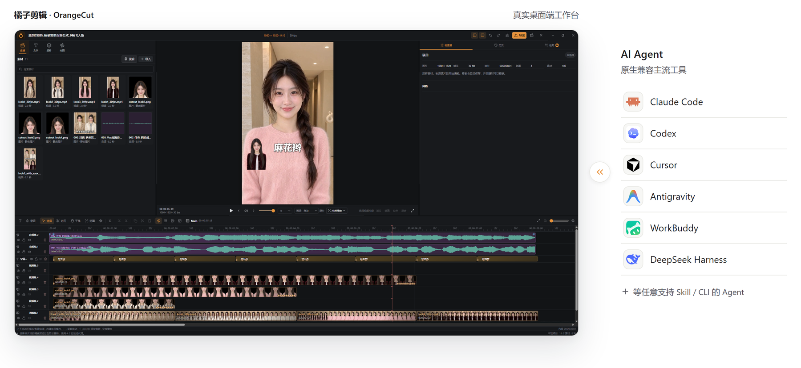
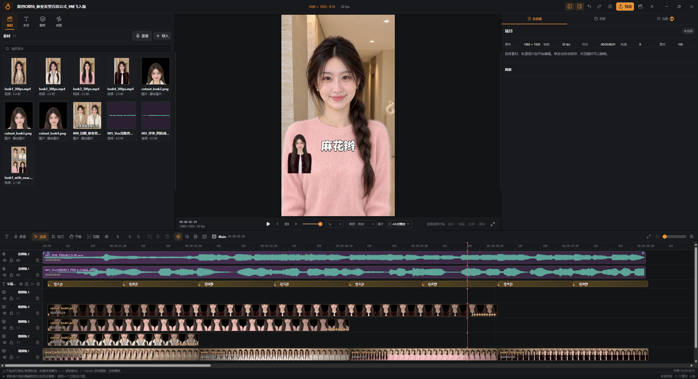

# OrangeCut · 橘子剪辑

**Agent 原生视频剪辑软件 · AI 直接剪，你随时预览微调。**

**中文** | [English](./README.en.md)

[官网下载](https://orangecut.timor419.com/desktop) · [安装 SOP](./INSTALL.md) · [统一 Skill](./skills/orangecut/SKILL.md) · [帮助中心](https://orangecut.timor419.com/help)

## 什么是 OrangeCut？

OrangeCut 是面向短视频创作的 **Agent-Native Video Editor**：AI Agent 理解素材、组织叙事并调用本地 CLI；OrangeCut 保存真实可编辑工程，提供非破坏性多轨时间线、桌面实时预览与确定性导出。

| 方式 | 适合做什么 | 修改与交付的边界 |
| --- | --- | --- |
| 纯黑盒 AI 视频生成 | 从描述生成新镜头 | 输出通常是成片，难以逐项调整剪点、字幕与混音 |
| 纯 FFmpeg 脚本 | 编码、滤镜与批处理 | 缺少可直接审片微调的桌面时间线，返工往往要改脚本 |
| OrangeCut + AI Agent | 素材编排、字幕、精剪与反复审片 | AI 直接剪，人工随时预览、调整或撤销，工程保留编辑结构 |

OrangeCut 不内置聊天助手，也不代替上游文生视频、配音或模型服务。你选择 Agent 与生成工具，OrangeCut 提供可审阅、可返工的剪辑执行环境。

## 1 分钟快速开始

### 复制一句话交给 AI 助手

“一分钟”指提交安装请求，不是完整下载或安装耗时承诺。将下面整段复制给支持本地命令的 AI 助手：

~~~text
请从 https://github.com/puke3615/OrangeCut-Skill 完整获取可信分发镜像，读取 INSTALL.md、manifest.json 和 agent-update.json，先确认当前 Agent 的 Skill 目录，再按 SOP 在我的 Windows x64 用户目录安装 OrangeCut v0.1.0 与统一 orangecut Skill/oc CLI；严格核验 ZIP 和 Agent 组件的大小与 SHA256、刷新 PATH，运行 oc --version 和 oc license status --json；失败即停，不跳过校验、不索取管理员权限、不覆盖不受管 Skill 或删除已有工程。
~~~

也可以先到 [官网桌面下载页](https://orangecut.timor419.com/desktop) 获取运行包，再按 [INSTALL.md](./INSTALL.md) 完成校验与 CLI/Skill 注册。不要只下载 README 或单独执行未知来源的安装脚本。

安装后自检：

~~~powershell
oc --version
oc license status --json
~~~

前者检查 CLI 版本；后者查询桌面服务裁定的社区版/Pro 状态，不会替你购买或激活。仅查询已有服务可用 `oc --no-autostart license status --json`。安装成功不等于授权成功，也不代替桌面启动、素材预览与人工审片。

## 原生兼容的 AI Agent 生态

支持 **Claude Code、OpenAI Codex、Cursor、Antigravity、WorkBuddy、DeepSeek Harness**，以及任意能够读取 Skill 并执行本地 CLI 的 Agent。兼容指共享 `orangecut` Skill 与 `oc` 命令契约，不代表六款工具采用同一安装器或已经逐版本独立认证。

| Agent | Skill 目录与注册方式 |
| --- | --- |
| OpenAI Codex | 通常使用用户级 `~/.codex/skills/orangecut/`；SOP 默认 Agent home 为 `~/.codex` |
| Claude Code | 通常使用 `~/.claude/skills/orangecut/`；按 SOP 将 Agent home 改为自己的 `~/.claude` |
| Cursor | 按当前版本的用户级/项目级 Skill 设置注册；使用其支持的 `skills/orangecut/` 目录，不套用 Codex home |
| Antigravity | 在该 Agent 的 Skill 配置中注册 `skills/orangecut/`，先确认实际目录与发现机制 |
| WorkBuddy | 按该 Agent 的 Skill 导入或目录配置注册同一 Skill，确认本地 CLI 执行权限 |
| DeepSeek Harness | 由所用 Harness 的 Skill loader 指向同一目录，确认可调用本机 `oc` |

不同 Agent 的 home、项目作用域与重载方式可能不同；目录必须由用户或该 Agent 的配置确认。不能确认就停止注册，不猜路径、不卸载其他 Agent 的 Skill。安装后让 Agent 重载 Skill，并运行 `oc --version` 验证命令可发现。

## 核心功能与产品亮点

### Agent 原生 CLI 与统一版本感知 Skill

`oc` 提供本地语义剪辑命令；`orangecut` Skill 负责指导 Agent 使用这些命令。只维护一套基础 Skill，自动感知社区版/Pro，激活 Pro 不需要重装。Agent 在进阶插件、硬编与高分辨率导出前查询授权；社区版默认走免费路径，不反复重试受限操作。

### 真实桌面实时预览与人机协同审片

AI 与桌面共用同一个 **Live Session**，不是另起一份看不见的工程。Agent 可提交 **ProposedChangeSet** 可审阅提案，用户接受后才应用为正式修改；支持线性撤销/重做。实时桌面预览让你对照素材检查剪点、文字与声音，再继续让 AI 调整。截图展示真实工作台，不是概念设计图。

### 内置离线中文 ASR 与开源字体

运行包内置 **Paraformer 中文自动语音识别（ASR）** 与开源字体库，用于本地转写与字幕制作，无需额外购买云端语音识别 API。首次准备 Python/uv 或按需安装插件仍可能联网；离线 ASR 不等于全部安装与所有 AI 服务都离线。

### 非破坏性语义时间线

多轨音视频、字幕、花字、贴纸、转场、关键帧与音频混音保留在可编辑工程中，而不是只剩一个不可拆分的输出文件。可以继续调整时长、位置、样式和节奏。所有持久修改经语义命令校验并记录事件；未支持的能力明确失败，不静默降级。

### 面向垂直场景的可扩展 Skill 架构

一套基础 `orangecut` Skill 可以向上组合书单号、文化美食、口播精剪、影视解说等垂直创作流。场景 Skill 负责创意、素材和剪辑规则，基础 Skill 负责统一编辑手脚；这是一种扩展方式，不代表内置每种场景的一键生成服务。素材使用权与上游服务由用户自行确认。

### 本地优先、低侵入便携安装

Windows x64 运行包安装到当前用户目录，无需管理员权限；社区版不强绑账号。SOP 核验桌面 ZIP 与 Agent 更新资源的大小和 SHA256，再调用官方注册器，经显式参数注册用户 PATH 与桌面快捷方式。不修改系统 PATH、不清空工程或授权数据。摘要校验保障字节完整性，不能代替发布者签名。

## 工作原理

~~~mermaid
flowchart LR
    A[原始素材与创意需求] --> B[AI Agent 读取 orangecut Skill 并调用 oc CLI]
    B --> C[OrangeCut 桌面实时预览与人工微调]
    C --> D[确定性无水印导出]
~~~

Agent 负责理解与编排；OrangeCut 负责工程真值、审阅与执行。导出应在桌面审片后进行，确定性执行不等于创意质量自动验收。

## 社区版（免费）与 Pro 会员

采用类似 DaVinci 的 Freemium 分层：基础剪辑可长期免费使用，进阶本地处理与导出能力由 Pro 解锁。不是 DaVinci 的关联产品。

| 能力 | 免费社区版 | Pro 会员 |
| --- | --- | --- |
| 完整工程读写、AI/CLI 剪辑 | 支持 | 支持 |
| 桌面实时预览、审阅提案、撤销/重做 | 支持 | 支持 |
| 离线中文 ASR（Paraformer）、开源字体 | 内置免费 | 同样包含 |
| 横竖屏无水印 CPU 导出 | <= 1080p | 支持 |
| 19 个进阶本地 AI OCP 插件 | 需 Pro | 按需安装，受各插件依赖约束 |
| NVENC 显卡硬件编码加速 | 不支持 | 支持，需兼容 NVIDIA 硬件与驱动 |
| > 1080p（如 4K）导出 | 不支持 | 支持，仍受素材、资源与硬件条件约束 |
| 授权与定价 | 永久免费，无需激活码 | 最新套餐方案与开通方式统一以[官网定价页](https://orangecut.timor419.com/pricing)为准 |
| 免费云端算力、上游模型 API、Agent 额度 | 不包含，用户自备 | 不包含，用户自备 |

社区版尺寸的精确定义是长边 <= 1920 且短边 <= 1080，包含横屏与竖屏，不是任意长宽比都可无限延长。

客户端与 Skill 仅区分「免费社区版」与「Pro 会员」状态，不写死价格或微信号；最新套餐、优惠、开通与客服联系统一以[官方定价页](https://orangecut.timor419.com/pricing)为准（[联系客服](https://orangecut.timor419.com/pricing#contact)）。联网核验后最长可离线使用 14 天，以实际截止时间为准；停用 Pro 不删除已有工程，激活入口为桌面“设置 → 授权管理”。

## 仓库结构与安全边界

~~~text
OrangeCut-Skill/
├── README.md                 中文说明
├── README.en.md              English documentation
├── INSTALL.md                Windows x64 安装 SOP
├── manifest.json             桌面 ZIP 地址、大小与 SHA256
├── agent-update.json         绑定桌面摘要的 Agent 组件清单
├── skills/orangecut/         唯一统一 Skill 的公开镜像
├── agent-install/            官方安装器、CLI wheel 与 Skill payload
├── assets/                   官网与桌面截图
└── .gitattributes            禁止 Agent 资源换行转换
~~~

本仓库是**单向脱敏、允许列表导出镜像**，不含桌面主体源码或私有 Git 历史；公开镜像不作为反向开发源。仅分发安装所需的官方 CLI/Skill 资源与文档，不执行桌面源码构建。

`agent-update.json` 将每个组件文件的大小/SHA256 与已发布桌面 ZIP 绑定。纯 Skill/CLI 更新无需重打大 ZIP；SOP 校验后刷新组件，保留旧资源备份，不宣称旧 ZIP 已含新组件。`.gitattributes` 固定 `agent-install/** -text`，避免 Windows Git 自动换行破坏组件摘要。拒绝路径逃逸、符号链接/重解析点和未知文件；摘要不符或来源不可信就停止。

## 常见问题

**需要什么系统？macOS 可以安装吗？** 目前提供 Windows x64 便携包，SOP 使用普通 PowerShell 5.1+；不是 ARM64 安装链路。请预留 ZIP、解压目录和升级备份空间。macOS 暂未提供便携包验收，不适用本 Windows SOP，不承诺已可交付。

**没有 Python 或 uv 怎么办？** SOP 先检测已有环境，排除 WindowsApps Python 占位程序，再按官方固定来源准备缺失依赖。无需管理员权限，但首次安装可能需要联网；依赖校验失败就停止。

**国内下载与代理怎么处理？** 官方分发直链（`orangecut-dl.auroraflow.co`）与 `orangecut.timor419.com` 默认直连；GitHub Releases 等备用地址在设置 `HTTPS_PROXY` 后显式走代理。`ORANGECUT_PROXY_ALL=1` 可强制所有 SOP 下载使用该代理。uv 下载受管 Python 仍遵循自身代理规则。

**SmartScreen 或企业安全策略拦截怎么办？** 先核对官方来源、大小与摘要，并检查文件属性和安全软件提示。SHA256 不代表代码签名，也不保证免警告。不要关闭安全软件、绕过企业策略或索取管理员权限；不能确认安全就停止并联系帮助中心。

**能把文生视频、TTS 和 Agent 订阅一起免费提供吗？** 不能。社区版与 Pro 都不含上游 AI 生成服务、云端算力或 Agent/API 额度。由你自行选择、配置并承担相应费用；OrangeCut 不内置聊天或供应商编排。

**升级会清空工程或强制付费吗？** 不清空工程与授权凭据；SOP 保留旧资源备份，不合并旧安装组件。Pro 不可用时仍可使用社区版的工程读写与基础导出。不要通过删除用户目录来处理安装冲突。

## 官方链接

- [官网](https://orangecut.timor419.com)
- [Windows 桌面下载](https://orangecut.timor419.com/desktop)
- [定价与开通 Pro](https://orangecut.timor419.com/pricing)
- [联系客服](https://orangecut.timor419.com/pricing#contact)
- [帮助中心](https://orangecut.timor419.com/help)
- [OrangeCut-Skill 公开仓库](https://github.com/puke3615/OrangeCut-Skill)
